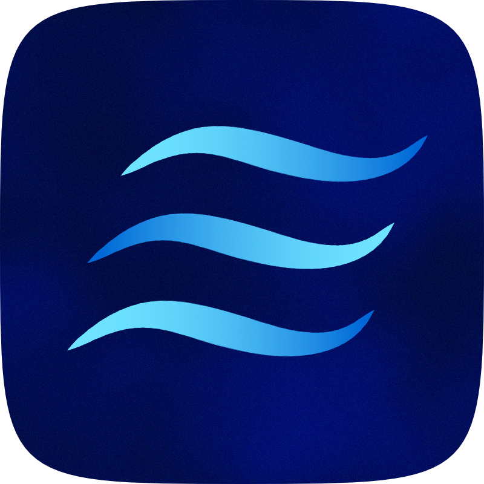
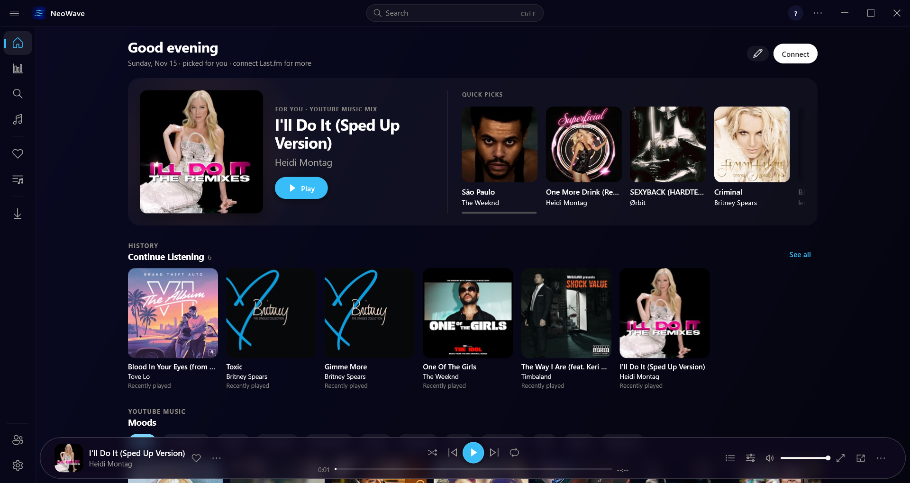
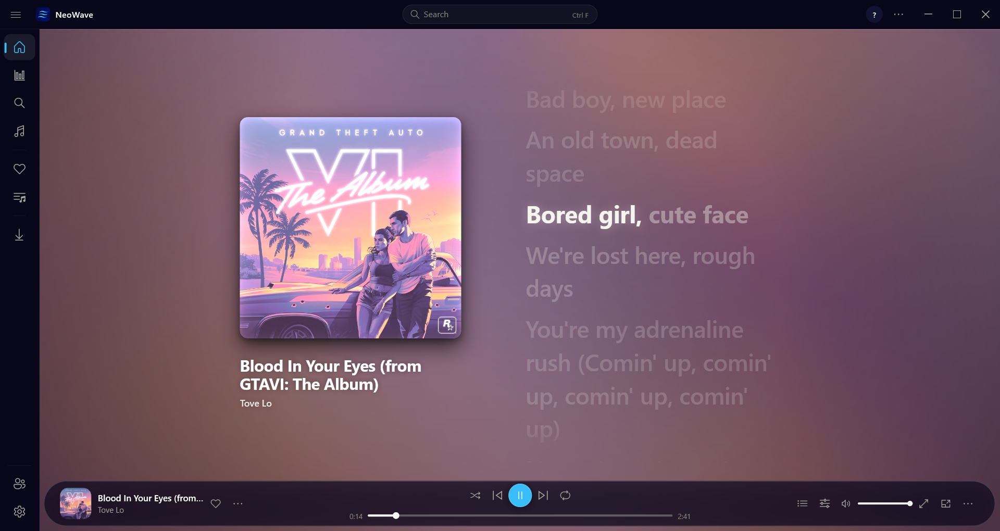
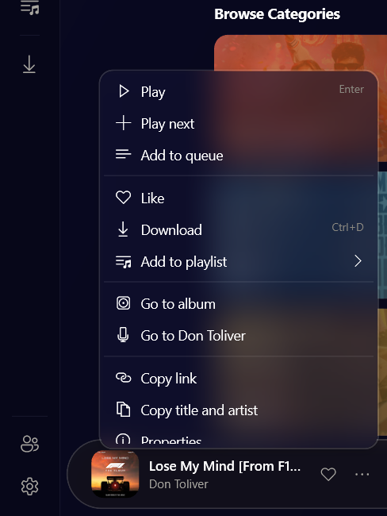

#  NeoWave

A desktop music player for YouTube Music, with word-synced lyrics and Last.fm scrobbling. Built with Flutter for Windows and Linux.

<table>
  <tr>
    <td width="50%"></td>
    <td width="50%"></td>
  </tr>
  <tr>
    <td colspan="2" align="center"></td>
  </tr>
</table>

## Features

- Play and search YouTube Music, and sign in to see your library
- Word-by-word synced lyrics
- Official album art from iTunes and Deezer
- Last.fm scrobbling and a home feed based on your listening
- Gapless playback, crossfade, equalizer and offline downloads

## Install

Get the latest build from [Releases](https://github.com/MrinmoyHaloi/NeoWave/releases).

## Setup

NeoWave doesn't bundle a Last.fm key. Create your own at [last.fm/api/account/create](https://www.last.fm/api/account/create), then enter it in **Settings → Integrations → API keys**.

## Build

```sh
flutter pub get
flutter run -d windows   # or: -d linux
```

On Linux, install `libmpv-dev`, `libayatana-appindicator3-dev`, `libasound2-dev` and `libkeybinder-3.0-dev` first.

## Credits

NeoWave started as a fork of [LastWave Desktop](https://github.com/clash-projects/lastwave-desktop). Thanks to clash-projects for the initial base.

## Disclaimer

NeoWave is an independent, non-commercial project for research and education. It is not affiliated with or endorsed by Google, YouTube, Apple, Last.fm or any music service. It doesn't host or distribute copyrighted media. All trademarks belong to their owners.
